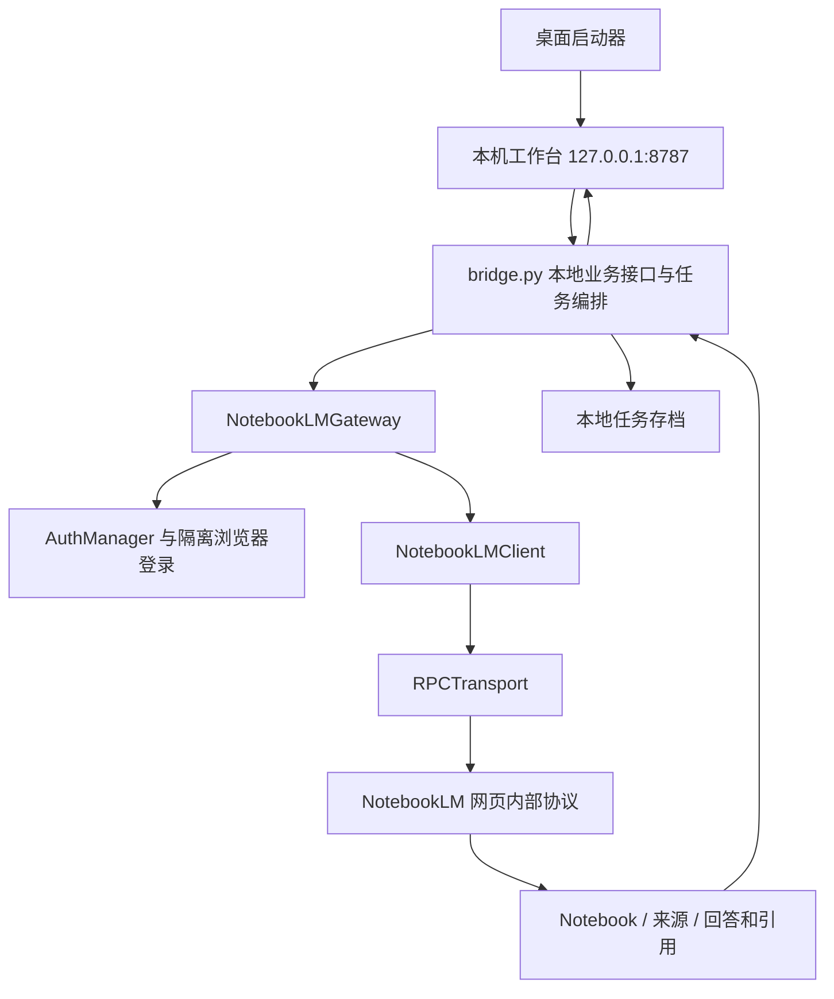
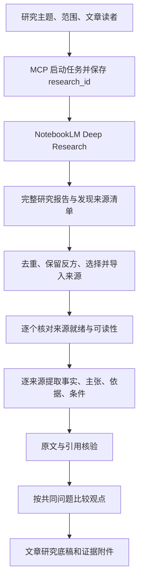

# OA阅答的 NotebookLM 接入链路与知识调研 MCP 方案

核验日期：2026-10-16（北京时间）

本文用于另一个项目的设计与开发交接。依据为 OA阅答当前源码、《设计专利OA审通分析软件》聊天中的项目背景、上游仓库源码及 Google 官方文档。本轮新增的是研究文档，没有修改软件、安装 MCP、使用登录凭据或发起真实研究。文中“已实现”指源码已有实现；“建议”指新项目待建设。

## 1. 结论与建议

可以把 NotebookLM 的能力接成面向文章调研的 MCP。现有 OA阅答已经证明了清晰的模块边界：业务流程调用 Gateway，Gateway 再调用认证、Notebook 客户端和网页协议层。但当前 OA阅答实现的是“指定材料上传后问答”，尚未实现 Deep Research。

建议新项目先评估原始参考项目 [jacob-bd/gemini-notebook-mcp-cli](https://github.com/jacob-bd/gemini-notebook-mcp-cli)，复用它已有的 MCP 和研究入口；将开发重点放在“逐来源提取证据—比较观点—生成文章研究底稿”。OA阅答的隔离登录、任务保存、失败恢复和引文展示经验，可作为加固参考。

最终交付物应让作者回答三个问题：这个知识由什么事实和材料支撑；各来源具体说了什么；哪些结论一致、哪些不同、为什么不同。仅有一篇研究报告和一串网址，不能充分满足这个目标。

## 2. 现有 OA阅答的整体链路



工作台和 NotebookLM 之间有两段连接：浏览器工作台通过本机 HTTP 接口访问 OA 业务服务；业务服务通过带会话认证的 HTTPS 请求访问 Google。当前本机 HTTP 服务并不是 MCP Server，也没有要求 AI 客户端通过 MCP 协议调用它。

关键源码入口：

| 层次 | 实际入口 | 负责什么 |
| --- | --- | --- |
| 启动 | [desktop/launcher.py](../desktop/launcher.py#L42) | 恢复本地任务、启动服务、打开工作台 |
| 前端 | [web/app.js](../web/app.js#L1339) | 提交材料、轮询任务、展示分析和引文 |
| 业务编排 | [bridge/bridge.py](../bridge/bridge.py#L1205) | 创建或复用笔记本、上传、提示词、分析、保存 |
| 稳定业务接口 | [gateway.py](../bridge/notebooklm/gateway.py#L14) | 隔离业务与 Google 协议细节 |
| 认证 | [auth.py](../bridge/notebooklm/auth.py#L34) | 本机 Profile、Cookie、网页令牌、认证失效 |
| 登录捕获 | [cdp.py](../bridge/notebooklm/cdp.py#L253) | 普通窗口登录后，通过短时 CDP 读取会话 |
| Notebook 操作 | [client.py](../bridge/notebooklm/client.py#L16) | Notebook、文件来源、来源状态、问答、引文解析 |
| 网络协议 | [transport.py](../bridge/notebooklm/transport.py#L55) | 请求封装、令牌刷新、上传、响应解包和重试 |

现行决策见 [ADR-0001](../docs/adr/0001-internal-notebooklm-bridge.md#L1)。旧的桥接规格（内部历史记录，不随本仓库提供）可追溯设计背景，但其中 URL 来源、生成物下载、多账号等规划不能视为本项目已实现功能；当前源码优先。

## 3. 登录与连接验证

### 3.1 实际步骤

1. 用户点击“连接 NotebookLM”，前端请求 `POST /api/notebook/login`。
2. `AuthManager.begin_login()` 启动后台登录任务，接口立即返回状态。
3. 使用 OA阅答自己的 Chrome/Edge 用户目录打开普通登录窗口；交互登录阶段不启用远程调试。
4. 用户自己向 Google 完成登录。程序先观察隔离目录中的 Cookie 名称等状态，不在该步骤读取密码。
5. 关闭程序启动的登录窗口，再用同一隔离目录启动短时会话捕获窗口。
6. 通过 CDP 读取 Cookie 及页面元信息，解析 CSRF、session ID、build label 和实际 Notebook 主机。
7. 将会话保存在本机，随后使用 `list_notebooks` 做真实在线验证。存在 Cookie 文件本身不代表当前已连接。

相关实现：[普通登录命令](../bridge/notebooklm/cdp.py#L142)、[登录捕获](../bridge/notebooklm/cdp.py#L253)、[在线探针](../bridge/notebooklm/gateway.py#L21)。

### 3.2 存储与迁移

打包版默认根目录为 `%LOCALAPPDATA%\OA阅答`，源码运行默认使用项目的 `output`。其下的 `notebooklm-native/profiles/default` 保存 `cookies.json`、`metadata.json`；`chrome-profiles/default` 保存隔离浏览器资料。用户选择的案件存档目录与认证根目录是两个概念，见 [初始化逻辑](../bridge/bridge.py#L39)。

旧 CLI 的兼容方式是一次性复制 `~/.notebooklm-mcp-cli/profiles/default` 中已有的会话导出文件；没有继续执行旧 CLI。新项目宜使用自己的应用目录，关闭这种隐式迁移，避免继承 OA阅答账号。当前 `auth.py` 采用 JSON 文件保存会话；本轮未发现该模块实施系统密钥库加密，不能把“本地保存”写成“已加密”。

## 4. 材料提交、分析与追问

### 4.1 提交前

材料先进行解析、必要的 OCR 和质量确认。可直接读取的 PDF/DOCX 发送文件原件；扫描件发送本机生成的 OCR Markdown；旧 DOC 先转换。每份材料只选一个实际上传版本，并在 `notebook-upload` 下保存清单及副本。相关入口：[archive_notebook_sources](../bridge/bridge.py#L1077)。

前端提交到 `POST /api/notebook/submit`，携带 OCR 任务编号、案件/轮次、可选已有 Notebook ID 及确认标记。后端检查材料完成状态、在线认证和重复任务，然后创建后台任务，前端通过 `GET /api/notebook/jobs/{id}` 轮询。

### 4.2 后台提交顺序

```text
queued
  → creating_notebook 或 using_existing_notebook
  → uploading_sources
  → configuring_analysis
  → generating_issue_list
  → complete / error
```

首轮可以创建 Notebook，后续轮次可复用同一案件已有 Notebook 并追加材料。`sourceCatalog` 保存来源 ID 与标题、本地路径、材料角色的对应关系。不是所有轮次都创建独立 Notebook；前端和早期文档中的个别描述不能覆盖当前后端行为。

文件上传先用 RPC 注册来源并取得 source ID，再建立 resumable 上传通道并发送文件。客户端轮询来源状态，当前实现将 `2` 视为可用、`3` 视为解析失败。只有可用后才进入后续问答。详见 [add_file / wait_for_source](../bridge/notebooklm/client.py#L79)。

### 4.3 三类问答

| 场景 | 当前处理 |
| --- | --- |
| 初始问题清单 | 配置专利研究提示词，再提问提取审查问题 |
| 选定审查类别 | 第一次请求提取审查意见，第二次请求形成答复策略；分别保存结果 |
| 继续追问 | 复用已有 Notebook，不再上传材料；已有追问时取其 conversation ID |

对应：[run_notebook_submission](../bridge/bridge.py#L1205)、[run_issue_analysis](../bridge/bridge.py#L1318)、[run_issue_followup](../bridge/bridge.py#L1409)。

NotebookLM 的返回内容在业务层被序列化为 JSON 文本保存。这里“保存了 JSON”是保存包含回答和引文的外层对象，不等于模型对所有研究主张已按严格 schema 输出。

## 5. 底层网页协议与引用回传

### 5.1 当前代码的三个端点

以下路径相对于客户端当前选定的 Google Notebook 主机；它们是网页内部协议，不是公开稳定 API。

| 用途 | 路径 |
| --- | --- |
| Notebook 等常规操作 | `/_/LabsTailwindUi/data/batchexecute` |
| 文件上传 | `/upload/_/` |
| 问答 | `/_/LabsTailwindUi/data/google.internal.labs.tailwind.orchestration.v1.LabsTailwindOrchestrationService/GenerateFreeFormStreamed` |

常规 RPC 把方法 ID 与参数数组包装进 `f.req`，以 Cookie 和 `at` 中的 CSRF 认证，带网页 build/session 等参数；响应去除 XSSI 前缀，解析 JSON 分块中的 `wrb.fr`。令牌失效时尝试刷新首页元信息，再进行有限重试。详见 [transport.py](../bridge/notebooklm/transport.py#L125)。

当前 OA 实现中的方法 ID 为：列 Notebook `wXbhsf`、读 Notebook `rLM1Ne`、创建 `CCqFvf`、配置聊天 `s0tc2d`、注册文件来源 `o4cbdc`、读会话 `khqZz`。它们支持 `OA_NLM_RPC_*` 环境变量覆盖。ID、参数形状和响应结构都可能变化；仅更换 ID 不能保证修复所有协议变化。

### 5.2 回答怎样变成可核验引文

`client.query()` 先列出现有来源并把所有 source ID 放入请求，再调用问答端点；解析回答、conversation ID 和引文，得到大致结构：

```text
answer
conversation_id
sources_used[]
citations: 回答内引文编号 → source_id
references[]: {source_id, citation_number, cited_text?}
```

业务层将 source ID 与 `sourceCatalog` 连接，前端把回答中的编号渲染成按钮，点击可显示对应材料名和摘录。关键位置：[query](../bridge/notebooklm/client.py#L128)、[引文解析](../bridge/notebooklm/client.py#L195)、[引文展示](../web/app.js#L1091)。

这是一套值得复用的“回答—引文—来源”映射。但它目前主要映射本地文件名，来源清单只返回 ID/标题/状态，没有完整网页 URL、作者、日期和来源全文。引用摘录也可能缺失，不能仅凭一个编号就宣布证据已核验。

## 6. 新项目不能直接照搬的部分

| 当前实现边界 | 对文章调研的影响 | 新项目处理 |
| --- | --- | --- |
| 无 Deep Research 入口 | 普通问答不会主动完成网页深度检索链路 | 增加真正的研究启动、状态和导入 |
| 只支持文件来源添加 | 不能完整管理研究发现的网页来源 | 补充 URL 导入及发现来源映射 |
| 问答自动选择全部来源 | 无法确保逐来源摘要只依据某一篇 | 支持显式 `source_ids`，单源提取时只选一个 |
| 自动取现有 conversation | 独立研究可能混入历史语境 | 逐来源分析使用新会话，追问才显式复用 |
| 流式端点一次 `read()` 完整返回 | 用户界面实际采用轮询，不是逐字流出 | 按任务方式返回进度；需要时再实现真正增量流 |
| 无正式答案时回退非最终文本 | 可能把中间内容当完成结果 | 缺少最终回答时标记 partial/parse_error |
| `turn_number=1`、`is_follow_up=False` 写死 | 不能据此准确判断会话轮次 | 使用真实会话记录或移除不可靠字段 |
| 全局 Gateway 主要使用 default profile | 传递 profile 字符串不等于按账号路由 | 在执行层强制绑定账号与任务 |
| 同名标题对账与通用网络重试 | 异常时可能重复创建或导入 | 按任务 ID、来源 ID、URL/内容哈希做对账 |

后几项是从当前源码得出的设计风险，不是本轮真实账号运行中已经复现的故障。特别是“先查远端再重试”有助于减少重复，但标题相同和请求结果不确定时，不构成严格幂等保证。

## 7. 原始参考项目现在能提供什么

本轮读取的上游 `main` 提交为 `a277ce7b81196222f79724b21973e17fc610999d`（提交日期 2026-10-15 UTC）。以下为静态源码核验，没有安装或实测该版本。

| 已有工具 | 适合本项目的用途 | 直接源码 |
| --- | --- | --- |
| `research_start` | 指定 web + deep，发起研究 | [research 工具](https://github.com/jacob-bd/gemini-notebook-mcp-cli/blob/a277ce7b81196222f79724b21973e17fc610999d/src/notebooklm_tools/mcp/tools/research.py) |
| `research_status` | 取得状态、报告和发现来源 | 同上 |
| `research_import` | 将选中结果导入 Notebook | 同上 |
| `source_get_content` | 取得 Notebook 索引的来源文本 | [source 工具](https://github.com/jacob-bd/gemini-notebook-mcp-cli/blob/a277ce7b81196222f79724b21973e17fc610999d/src/notebooklm_tools/mcp/tools/sources.py) |
| `notebook_query` | 指定来源集合提问，可使用新会话 | [chat 工具](https://github.com/jacob-bd/gemini-notebook-mcp-cli/blob/a277ce7b81196222f79724b21973e17fc610999d/src/notebooklm_tools/mcp/tools/chat.py) |

文章调研适配时，应单独核对这些细节：

- `research_status` 默认 `compact=True` 会裁剪报告和来源；保存研究证据时取完整结果，并与给 AI 的分页摘要分开。
- 研究完成与导入成功分别记录；不只依赖 `auto_import` 的总体标记，逐个核对来源是否可用。
- “报告引用了该来源”只是发现阶段的标签，不能直接证明某个具体主张受到原文支持。
- 实际导入集应显式保存，包含排除理由，不能靠 `cited_only` 参数名称推测结果。

上述行为见 [research 服务层](https://github.com/jacob-bd/gemini-notebook-mcp-cli/blob/a277ce7b81196222f79724b21973e17fc610999d/src/notebooklm_tools/services/research.py)。

此外，上游底层兼容了研究过程中任务 ID 变化的情况，但有“退回其他任务”的宽松匹配；部分研究结果条目也可能无 URL、属于报告类型，无法直接按网页来源导入。新项目应校验 Notebook、问题和任务关联，遇到歧义暂停该任务并报告，避免串用别次研究。来源 URL 不可得时保留缺口，不猜链接。[研究底层实现](https://github.com/jacob-bd/gemini-notebook-mcp-cli/blob/a277ce7b81196222f79724b21973e17fc610999d/src/notebooklm_tools/core/research.py)

建议优先“复用已存在的 MCP + 新增研究整理层”。只有实测发现上游无法满足关键需求时，再决定抽取 OA阅答桥接模块自行维护。若需要单一 MCP 入口，可用独立 facade 包装选定的上游服务方法；也可以先由宿主 AI 编排现有 MCP，避免为了转发工具再套一层。两种部署都需要固定依赖版本并独立管理登录资料。

## 8. 官方能力边界：需要更新旧认知

Google 官方网页确认：Deep Research 可产出报告和相关来源列表，包括未被报告引用的来源；用户可选择导入。达到来源额度时可能只导入部分。本文继续沿用“NotebookLM”，当前官方帮助页已使用 Gemini Notebook 名称。[来源发现帮助](https://support.google.com/gemininotebook/answer/16215270?hl=en)

不能继续笼统写“NotebookLM 完全没有官方 API”。应区分：

| 接入对象 | 当前核验结论 | 对新项目的含义 |
| --- | --- | --- |
| 个人 NotebookLM 网页 | 本轮未找到公开的 Deep Research 启动、聊天引文/全文导出 API 文档 | 第三方适配仍应明确标为非官方网页协议 |
| NotebookLM Enterprise | 有官方 Notebook 和来源管理 API，采用 Google Cloud 授权 | 不能直接拿个人 Cookie 作为其凭据；管理 API 不等于具备完整调研接口 |
| Gemini API Deep Research | 有独立官方研究 API | 可列为另选后端，不能当作已调用 NotebookLM |

依据：[Enterprise Notebook API](https://docs.cloud.google.com/gemini/enterprise/notebooklm-enterprise/docs/api-notebooks)、[Enterprise 来源 schema](https://docs.cloud.google.com/gemini/enterprise/docs/reference/rest/v1alpha/projects.locations.notebooks.sources)、[Gemini Deep Research](https://ai.google.dev/gemini-api/docs/deep-research)。更完整的官方资料核验见[配套笔记](../research/notebooklm-official-capabilities-2026-10-16.md#L1)。

## 9. 面向文章调研的新链路



### 9.1 研究输入

用户提供主题即可开始；可选输入包括具体研究问题、读者、时间和地域范围、语言、偏好来源和希望比较的维度。时间范围等检索要求应写入研究问题，并在结果中事后核对，不能假装 NotebookLM 一定提供相同的精确过滤器。

每个独立主题默认创建自己的研究 Notebook。任务状态保存 `research_id`、账号标识、Notebook ID、上游任务 ID、原始问题、实际模式、开始时间和来源集。重新连接客户端后继续查原任务，不能重新发起一遍研究来“恢复”。

### 9.2 先保存发现结果，再导入

保存完整报告、所有发现来源、报告引用关系和选择理由。可以优先官方文件、原始研究、原始数据及具名专业观点，同时保留有代表性的不同意见。报告没有引用的来源也可能包含重要反证，不能全部丢弃。

需要分别统计 `discovered / selected / imported / ready / readable / analyzed / verified`。来源数量、可读数量和核验数量不是同一个指标。遇到限额、付费墙、失效链接或缺 URL，记录原因并返回部分结果。

NotebookLM 的网页来源主要是给定页面的文本，嵌入图片、视频和下级网页不自动纳入；需要图表证据时另行核对。其索引文本也是某次导入的内容，不应自动当作原网页的当前全文。[Google 来源说明](https://support.google.com/gemininotebook/answer/16215270?hl=en)

### 9.3 每个来源单独做证据卡

每张卡至少包含：来源稳定 ID、URL、标题、作者/机构、发布或更新时间、取得时间、索引内容版本、主要主张、依据类型、短引文、定位、适用条件、局限，以及对文章哪个问题有用。拿不到的元数据用 null 或“未知”，不要由模型补齐。

逐来源请求必须限制到该来源并使用独立会话。可通过 NotebookLM 做提取，也可让宿主 AI 处理已取得的文本；无须默认再购买一个模型 API。结构化结果必须由软件校验，不能只靠提示词要求“输出 JSON”。

### 9.4 再比较共识、差异与证据强度

把主张对齐到同一问题之后，再区分：直接支持、直接反对、条件不同、术语口径不同、时间变化、证据强度不同、仅未提及。两篇文章讨论不同对象或不同指标时，不强行写成冲突。

同时区分来源自身的证据与它转述的证据。例如一篇评论引用某项实验，文章能证明“作者作此解释”，实验结论应尽量追到原论文。多个网页转载同一条新闻不算多份独立支持；保存共同原始来源与转载关系。

### 9.5 形成写作底稿

默认输出五部分：知识框架与关键概念；逐来源支撑表；观点差异及原因；可写角度和论证提纲；尚缺证据与待核验项。每个重要事实和差异判断关联 evidence ID，再连接到原文，而不是只在末尾堆参考链接。

研究报告是机器生成的综合材料，应单独标记；即使被导入 Notebook，也不能与其所依据的网页算成两份独立证据。不要自动发布文章。

## 10. 建议的 MCP 接口与数据约定

下面是新项目建议接口，尚未实现；不是现有 OA阅答接口，也不等于上游同名工具的参数定义。

| 工具 | 主要输入 | 返回内容 |
| --- | --- | --- |
| `nlm_auth_status` | 可选 profile | 本地/在线认证状态与下一步动作，不含凭据 |
| `nlm_research_start` | topic、可选 scope、request_key | 立即返回 research_id、notebook_id、状态 |
| `nlm_research_status` | research_id | 当前阶段、来源统计、错误、建议下次检查时间 |
| `nlm_research_result` | research_id、cursor、limit | 完整发现结果的分页读取、报告资源引用 |
| `nlm_research_import` | research_id、candidate_ids | 导入映射与逐来源状态 |
| `nlm_source_get` | research_id、source_id、可选段落范围 | 来源元数据、索引文本/摘录、版本与可读状态 |
| `nlm_notebook_query` | notebook_id、question、source_ids、可选 conversation_id | 回答、来源约束、可核验引用 |
| `nlm_evidence_build` | research_id、selected_source_ids | 启动逐来源证据卡生成，返回阶段任务号 |
| `nlm_viewpoints_compare` | research_id、questions | 比较证据卡，生成共识/差异/缺口 |
| `nlm_writing_brief_export` | research_id、可选格式/目录 | 研究底稿及证据附件位置 |

原子工具保证可组合，高层工具减少反复编排。长时间工作返回任务号，再通过状态/结果读取，不让一次工具调用持续占用整个研究时长。本地单用户先用 stdio，日志写 stderr。可以为支持客户端增加 MCP Tasks，但其当前规范仍为 experimental，需保留普通工具路径。[MCP 传输](https://modelcontextprotocol.io/specification/2025-11-25/basic/transports)、[MCP Tasks](https://modelcontextprotocol.io/specification/2025-11-25/basic/utilities/tasks)

取消能力应报告具体范围：停止本地后续分析，不应声称已取消 Google 远端研究，除非适配器确认支持并成功执行。

建议使用 `outputSchema` 和 `structuredContent`，全文以资源或分页返回，摘要明确写出截断情况。声明了 schema 后，服务层应检查字段、引用对应关系和错误状态。[MCP Tools](https://modelcontextprotocol.io/specification/2025-11-25/server/tools)

建议核心数据关系：

```text
ResearchJob
  research_id, request_key, provider, account_ref, notebook_id,
  upstream_task_id, topic, scope, status, coverage, errors

Source
  source_id, candidate_id, original_url, canonical_url, title,
  author, publisher, published_at, retrieved_at, text_hash,
  import_status, read_status, analyzed_status, provenance_group

Evidence
  evidence_id, source_id, source_text_hash, question_id,
  claim, claim_type, short_quote, locator,
  evidence_kind, conditions, limitations, verification_status

ViewpointComparison
  comparison_id, question_id, statements[], relation,
  reasons[], evidence_ids[], unresolved_questions[]
```

引文编号只在一次回答内部有意义。长期标识宜使用 `research_id + answer_id + citation_number`，同时关联稳定 source/evidence ID；不能把多次回答中的 `[1]` 合并成同一来源。发布文章前还应区分“原文摘录已匹配”“原文支持该解释”“已有独立证据互证”，三者分别记录。

## 11. 稳定性和验收重点

### 11.1 建议实现顺序

1. **验证研究底座：** 用独立应用目录评估上游 MCP，真实完成一次 deep 研究、完整取回报告与来源、选择导入、取来源文本、指定来源问答。先确认实际账号支持，再扩大开发。
2. **建设证据层：** 来源去重、逐源证据卡、原文定位、版本记录、支持/反对/条件差异比较；新增两到三个高层工具即可形成首个可用版本。
3. **增加恢复与导出：** 任务保存、幂等请求键、写操作结果对账、部分失败与额度处理，生成研究底稿附件。
4. **实际写作试用：** 用一个存在不同观点的主题，人工抽查重要结论和反方依据；修正结构后再考虑更多用户或远程部署。

### 11.2 必须达到的验收结果

- 能确认实际调用的是 NotebookLM Deep Research，且准确记录模式；失败时不静默换成 Fast Research 或另一产品。
- 列出完整发现集合与实际导入集合，不能把简略展示列表当全量；所有部分失败都有说明。
- 至少两篇来源能单独提取并定位证据，来源限制不会混入其他材料或历史会话。
- 至少一个比较判断可追溯到双方原文；“没有提及”不会被写成“反对”。
- 转载不会重复计为独立支持；报告与原始来源不重复计证据。
- 重启后恢复研究和来源进度，不重复发起研究或重复导入；超时先查询远端状态再决定重试。
- 新项目的账号、认证目录与 OA阅答隔离；凭据不进入 MCP 返回、研究附件或日志。

研究启动/导入是有副作用且可能消耗额度的操作，不应把 OA阅答的通用网络重试原样套用。优先对账，不能确定时保留“结果不确定”并继续查询。每个账号的来源抽取请求宜受限排队，避免对许多来源同时发起聊天。

## 12. 推荐交付目录与当前验证程度

新项目每次研究可以导出：

```text
research/<research_id>/
  manifest.json                 主题、账号引用、任务、来源覆盖统计
  notebooklm-report.md           完整原始研究报告
  sources.json                  发现、选择、导入、读取及去重映射
  evidence.json                 逐来源主张与原文支撑
  viewpoints.md                 共识、差异、条件与证据缺口
  writing-brief.md               文章角度、论证提纲、引用建议
```

正文/摘录如需本地留存，单独按来源保存其取得时间和内容版本；导出目录不得包含 Cookie、令牌或浏览器 Profile。默认研究结果可以保留网页链接与必要短引文，不需要把全部网页原文塞进文章底稿。

本轮已完成：现有项目源码链路追踪、原始聊天背景定位、上游指定提交静态核对、官方能力文档检索。使用隔离的临时 home 执行以下既有离线测试，共 **23 项通过**：

- `tests/test_notebooklm_native.py`
- `tests/test_notebook_login_browser.py`
- `tests/test_notebook_submission.py`
- `tests/test_issue_analysis_retry.py`

这些测试覆盖协议解析、模拟网络重试、来源上传对账及登录命令等逻辑，不证明当前 Google 线上协议、真实账号 Deep Research、真实来源全文和引文提取均已可用。新项目尚未实现或安装；下一步应从第 11 节的独立账号环境验收开始。
